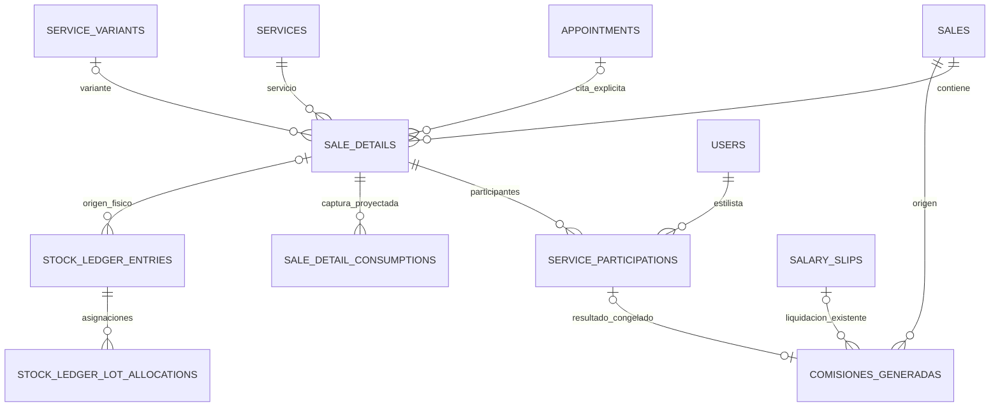

# H06-P — Modelo mínimo de prestación compartida

**Estado: propuesta para revisión, no implementada.** Solo se realizó inspección estática y documentación. No se creó migración, no se cambió código funcional ni se ejecutó SQL o pruebas de aplicación.

Referencias: [H06-R](H06_R_FACTURACION_CITAS.md), [H05-R](H05_R_VALIDACION_CARRITO.md), [H03-B2](H03_B2_IMPLEMENTACION.md), [H04-B](H04_B_REVERSIBILIDAD.md), [H16](H16_DISPONIBILIDAD.md) y [AGENTS.md](../AGENTS.md). Los esquemas aquí descritos proceden de archivos versionados, no de consultas a las bases actuales.

## 1. Diagnóstico de relaciones actuales

| Relación/campo inspeccionado | Qué permite reutilizar | Qué no demuestra |
| --- | --- | --- |
| `appointments.service_id`, cliente, estado y horario | Contexto de la cita; catálogo correcto `services` | Que se ejecutó el servicio ni cuántas ejecuciones hubo |
| `appointment_user(appointment_id,user_id)` | Asignación planificada de varios estilistas; mutex H16 | Participación histórica inmutable: no reemplaza el registro de participantes de una prestación |
| `sales.appointment_id` | Trazabilidad y bloqueo de otra venta aplicada, conservados por H06-R | A qué ejecución corresponde cada detalle de una venta mixta |
| `sale_details.id`, `sale_id`, `service_id`, `service_variant_id`, `quantity`, `unit_price` | Identidad de línea y términos comerciales congelados; una línea completa puede ser el ancla de una prestación | Hoy n líneas por estilista confunden participación y cantidad física; no hay clasificación explícita de esa representación |
| `sale_details.stylist_id` | Lectura de documentos legacy | No representa n participantes sin multiplicar líneas |
| `comisiones_generadas` | Venta, usuario, base, porcentaje e importe congelados; estados pendiente/pagada/anulada y enlaces de nómina | No identifica prestación ni participante dentro de una venta con varios servicios |
| `sale_detail_consumptions` | Auditoría por detalle/insumo de estándar y real, UNIQUE(detalle,insumo) | No distingue por sí sola captura completa, parcial y ausencia, ni congela el estándar cuando no hubo captura |
| `sale_details.consumption_snapshot` H03-B2 | Una fotografía versionada con modo, ingredientes, medidas, estándar y real; conserva ceros | No existe necesariamente en todos los perfiles; no debe habilitarse su lector fuera de la puerta autorizada |
| `stock_ledger_entries.sale_detail_id` y asignaciones H03 | Origen de salidas, lote, valores y restituciones desde el detalle | No prueba recepción física de material ni atención efectiva |
| `sales.annulment_evidence` H04 | Intención de inventario, constatación de cita, alcance y referencias originales | No es un registro contemporáneo de ejecución ni permiso para deducir prestaciones adicionales |

Se revisaron `VentaController`, `CarritoVentaService`, `AgendaService`, `InventarioService`, `CapturaConsumoService`, `ComisionService`, `AprobacionService`, `AnulacionVentaService`, modelos y migraciones correspondientes. Se inspeccionaron también los consumidores POS, administración de estructuras de comisión y contratos históricos H16.

Puntos que condicionan el diseño:

- `InventarioService` consume por detalle y multiplica por `quantity`; no debe recorrer participantes como si fueran unidades físicas.
- El POS heredado crea una línea por estilista y reparte el precio. H05 admite además líneas completas H16; no son prueba de ejecuciones distintas.
- `ComisionService` calcula sobre `quantity × unit_price` de cada detalle, bruto, sin restar descuento de cabecera. Resuelve rango/esquema vigente y luego fallback de perfil. La edición del perfil mantiene esos esquemas; no se sustituirá esa política.
- Aprobación aplica efectos después de retención. Cotización/retención no genera todavía comisiones ni movimientos físicos.
- `store` actualmente borra y recrea detalles al editar borradores. Ese patrón no sirve para una identidad de prestación que ya deba conservarse.
- La variante usa una FK que puede quedar NULL al eliminarla; conservar precio no conserva por sí solo la identidad descriptiva de la variante.
- H03/H04 ya enlazan evidencia y movimientos al detalle. Crear otro propietario de consumo duplicaría rutas físicas y de reversión.

## 2. Alternativas consideradas

| Diseño mínimo viable | Persistencia | Ventajas | Riesgos y coste real |
| --- | --- | --- | --- |
| **A. Línea canónica como ancla de prestación + participantes** | Reutilizar `sale_details`; una tabla `service_participations`; identificadores/versionado y enlace de comisión aditivos | Precio completo y cantidad una sola vez; fotografía y kárdex siguen en su propietario actual; conserva el motor financiero y de reversión | Debe impedir borrar/recrear el ancla; obliga a tratar explícitamente retirada de propuestas; una prestación no puede existir fuera de un documento comercial en este alcance |
| **B. Prestación independiente + participantes** | `service_performances` y `service_participations`; relación explícita con líneas y comisiones | Identidad independiente de la factura; permite conservar una prestación al reemplazar su representación comercial o documentarla antes de facturar | Hay que decidir propietario de precio/fotografía, estados y transferencia entre documentos; más FK, coordinación y lectores; facilidad para duplicar servicio, cantidad, snapshot y ciclo de vida |

Ambas son técnicamente viables bajo sus contratos. B sería necesaria si se exige ejecutar/documentar una prestación antes de tener documento, vincularla a varias facturas, reemplazar factura sin repetir prestación o conservar su identidad tras retirar una línea comercial. Esas capacidades no están autorizadas por H06 y no se introducen por conveniencia arquitectónica.

**Se recomienda A para el alcance actual**, sujeto a aceptar el tratamiento de borradores de §11. Su tabla nueva se justifica por una cardinalidad inexistente: n participantes independientes por una misma prestación. No se crea una tabla nueva de prestaciones ni de recetas, pagos o comisiones. Si se exige mantener la eliminación arbitraria de líneas de borrador y conservar además su identidad documental, debe elegirse B o autorizar otro archivo de propuestas; no ocultar esa necesidad bajo borrado físico o registros de precio cero.

Alternativas descartadas: JSON de participantes sin FK/UNIQUE; usar comisiones como participación; usar asignación actual de agenda como historia; filas financieras secundarias con cantidad cero; agrupación por precio/código/notas; otro identificador en cada movimiento de stock. No garantizan el contrato o duplican información que ya puede seguirse desde `sale_detail_id`.

## 3. Diseño mínimo recomendado

### 3.1 Contrato de identidad y cantidad

Para documentos nuevos con contrato explícito:

1. Una línea de servicio canónica contiene **el precio completo**, no una fracción por participante. `performance_key` identifica establemente esa prestación dentro del sistema y `sale_details.id` conserva el ancla técnica existente.
2. La prestación compartida habitual tiene `quantity=1`. El número de participantes nunca modifica esa cantidad.
3. `quantity=q>1` significa q ejecuciones reales **homogéneas expresamente declaradas**, al mismo precio unitario, variante, participantes y consumo por unidad. La línea identifica ese lote homogéneo; no promete identidad individual de cada una de sus q unidades. Conserva la semántica cuantitativa H05 y la base actual `q × precio`, sin multiplicar otra vez por participantes.
4. Si son dos prestaciones distintas, necesitan identidad individual, distinto consumo o distinta participación, son dos líneas/keys, normalmente con cantidad uno cada una. No se fusionan por semejanza.
5. En una cita ordinaria solo se admite por defecto la prestación única ya confirmada, con cantidad uno. Un `performance_key` distinto, `quantity>1` o varias líneas completas H16 **no acreditan** nuevas ejecuciones de esa misma cita: requieren contrato/evidencia adicional y quedan bloqueadas en esta propuesta mínima.
6. Una venta puede contener productos y varias prestaciones explícitas. Se mantiene por ahora el límite H05/H06 de una cita por venta; otras prestaciones de esa venta pueden no tener cita. No se habilita silenciosamente una factura con varias citas.

Esto distingue participación de repetición verdadera sin inferirla de estilistas, precios o nombres. El identificador identifica una declaración/documento; no acredita por sí solo que el servicio ocurrió. La constatación de atención para H04 conserva su significado independiente.

### 3.2 Autoridad de cada dato

| Dato | Fuente persistente única / derivación |
| --- | --- |
| Identidad | `sale_details.id` + `performance_key` inmutable; no reutilizar una key anulada para otra prestación |
| Servicio, variante vigente y unidades comerciales | Campos existentes del detalle; cantidad también declara las ejecuciones homogéneas reales |
| Identidad descriptiva histórica del servicio/variante | Snapshot comercial mínimo, para sobrevivir a nombres cambiados o FK de variante puesta a NULL |
| Precio unitario bruto, moneda base | `unit_price` existente en NIO; no repetirlo en participantes |
| Base total de comisión | Derivar exactamente de `quantity × unit_price` al aplicar; guardar en `ComisionGenerada.monto_venta`, que ya es el registro económico congelado |
| Participantes | Filas `service_participations`; no leer el pivot de agenda para recalcular una venta emitida |
| Porcentaje/importe congelados | Campos existentes de `comisiones_generadas`; no otra tabla de importes |
| Procedencia del porcentaje/esquema | Snapshot técnico de resolución en participante; los IDs de catálogo son informativos, no permisos para recalcular |
| Composición/consumo | Una `consumption_snapshot` H03 por detalle y proyección de captura completa en `sale_detail_consumptions` según contrato existente |
| Movimiento y costo | Kárdex/asignaciones originales enlazados al detalle; no copiar el costo real a participantes |
| Aplicado/pendiente/anulado | Estado y evidencia de la venta existente, más existencia/conciliación de sus efectos; no crear otro ciclo financiero por participante |

Las filas de consumo H03 y su JSON no son dos fotografías independientes: las primeras son proyección auditable, deben coincidir con el JSON y nunca sumarse como otra demanda. Los snapshots comerciales conservan identidad mutable de catálogo, no duplican precios/totales.

## 4. Diagrama de relaciones



La foto única es un atributo del detalle canónico; el diagrama no añade una tabla de snapshots. `sales.appointment_id` permanece como resumen compatible de la única cita, validado contra los detalles nuevos. Los productos no tienen participantes de prestación ni `performance_key`.

## 5. Especificación candidata de tablas, columnas y migración

**Especificación documental, no DDL ejecutado ni archivo de migración.** Nombres sujetos a la revisión final. Tipos/FK deben cotejarse con un esquema autorizado antes de escribir la migración. No se alteran perfiles AC-05 ni se añade todo H03 implícitamente.

### 5.1 `sales`: contrato, reenvíos y revisión legacy

| Columna nueva candidata | Tipo / restricción | Motivo |
| --- | --- | --- |
| `service_contract_version` | TINYINT UNSIGNED NULL; NULL o 1 | NULL conserva lectura legacy; 1 exige DTO y representación nueva en todos los servicios del documento |
| `creation_key` | CHAR(36), ASCII/collation binaria, NULL; UNIQUE | Reconocer creación/emisión repetida, incluso si el documento queda retenido; no es autorización ni prueba de ejecución |
| `creation_request_hash` | CHAR(64) ASCII NULL | Hash canónico de intención validada para rechazar la misma key con otro contenido |
| `document_revision` | BIGINT UNSIGNED NULL; positivo para versión 1 | Evitar sobrescritura de una propuesta por un editor desactualizado |
| `legacy_review` | JSON NULL | Registrar explícitamente ambigüedad detectada por revisión, sin inventar prestaciones ni cambiar importes |

CHECK de fila: o versión/clave/hash/revisión son NULL (legacy), o versión=1 y los otros tres son no nulos, de forma válida y revisión positiva. `legacy_review` no clasifica masivamente documentos; su escritura futura necesita acción de revisión autorizada. Contenido mínimo: versión, estado `blocked_ambiguous`, códigos de conflicto, actor/fecha, huella del documento y referencias de evidencia. No es un motor de aprobación ni cambia `sales.status`. Una huella no prueba que el hecho ocurrió.

No se propone guardar respuesta HTTP completa, credenciales o payload de pagos duplicado en estos metadatos. El hash no sustituye validación; se calcula de intención normalizada, no de precios actuales recalculados en un reintento.

### 5.2 `sale_details`: ancla canónica

| Columna/índice candidato | Restricción | Motivo |
| --- | --- | --- |
| `performance_key` | CHAR(36) ASCII binaria NULL; UNIQUE | Identidad estable solo de prestaciones del contrato nuevo |
| `appointment_id` | BIGINT UNSIGNED NULL; FK a `appointments.id`, RESTRICT delete/update; índice | Conservar vínculo por prestación en venta mixta, no inferirlo del servicio |
| `commercial_identity_snapshot` | JSON NULL | Servicio/variante: IDs y etiquetas al preparar, versión del contrato; sin repetir importes financieros |
| UNIQUE `(id,sale_id)` | Índice de soporte de FK compuesta | Asegurar en SQL que participante y detalle pertenecen a la misma venta |

No se añaden otros `service_id`, `variant_id`, `execution_quantity`, precio, base o fotografía a una entidad paralela. Se reutilizan las columnas existentes. CHECK de fila para `performance_key` no nulo: `service_id` no nulo, `item_id` nulo, `quantity>0`, `unit_price>=0`, `stylist_id IS NULL`, snapshot comercial no nulo y con forma/versionado reconocido. Si la key es NULL, las dos columnas nuevas de contexto también deben ser NULL, sin imponer reglas retrospectivas sobre los campos legacy.

El vínculo comercial y snapshot se contrastan al confirmar. Si la variante del catálogo desaparece posteriormente, su identidad declarada sobrevive en el snapshot aunque la FK existente quede NULL; no se reescribe el precio ni se revive el catálogo. La aprobación usa los términos congelados, no vuelve a consultar la tarifa para cobrar otra.

`stylist_id=NULL` en nuevo servicio no significa «sin asignación»: significa que la participación se consulta en su tabla. Los lectores de tickets/documentos/reportes deben conocer la versión antes de habilitar creación. No conservar un «principal» ficticio para ocultar un lector sin adaptar. Las líneas de producto y las legacy conservan su contrato.

### 5.3 Nueva `service_participations`

| Columna | Tipo / regla |
| --- | --- |
| `id` | BIGINT UNSIGNED PK |
| `sale_detail_id` | BIGINT UNSIGNED NOT NULL |
| `sale_id` | BIGINT UNSIGNED NOT NULL |
| `user_id` | BIGINT UNSIGNED NOT NULL; FK `users.id` RESTRICT delete/update |
| `commission_resolution_snapshot` | JSON NULL antes de aplicar; congelado al resolver |
| `created_at`, `updated_at` | Convención existente; no cambian importes ya aplicados |

Restricciones:

- UNIQUE `(sale_detail_id,user_id)`: una participación por estilista y prestación, no por precio o nombre.
- FK compuesta `(sale_detail_id,sale_id)` → `sale_details(id,sale_id)`, RESTRICT delete/update.
- UNIQUE `(id,sale_id,user_id)` para la FK de comisión.
- Índices de consulta por `sale_id` y `user_id` según los anteriores y el plan real, sin duplicarlos innecesariamente.

`sale_id` repite un dato derivable, pero se justifica exclusivamente para verificar pertenencia con FK compuestas; no duplica un importe. Se conserva `user_id` porque `comisiones_generadas.empleado_id` referencia `users`, no `employees`. No se cambia H07 ni la separación user/employee.

Snapshot de resolución mínimo: versión, fuente `profile/scheme/range`, identificadores informativos de esquema/rango, vigencia observada y límites/orden utilizados para seleccionar rango. Porcentaje y monto efectivos tienen autoridad en la comisión congelada. Si la resolución produce cero y la política actual no crea fila económica, el snapshot debe conservar explícitamente porcentaje cero y resultado cero para distinguirlo de «todavía no resuelto».

### 5.4 `comisiones_generadas`

- Añadir `service_participation_id BIGINT UNSIGNED NULL`, UNIQUE.
- FK compuesta `(service_participation_id,venta_id,empleado_id)` → `service_participations(id,sale_id,user_id)`, RESTRICT delete/update.
- Los NULL de legacy se mantienen. No modificar porcentajes, bases, montos, fechas, estados ni enlaces a colilla/período existentes.
- La unicidad impide repetir una comisión económica para el mismo participante. La FK impide atribuirla a otro usuario u otra venta. El código comprueba además que la participación pertenece a una línea canónica de servicio del contrato nuevo, así como base completa y resolución válida antes de insertar; una FK a detalle no comprueba su tipo de línea.

No se referencia por FK un esquema/rango mutable como si fuera la autoridad del importe histórico: el snapshot conserva la procedencia y la comisión conserva el resultado. Tampoco se reemplaza `ComisionGenerada` por otro libro.

### 5.5 Fotografía y referencias físicas existentes

Reutilizar `sale_details.consumption_snapshot`, UNIQUE `(sale_detail_id,item_id)` en consumos, `stock_ledger_entries.sale_detail_id` y asignaciones H03/H04. **No añadir** otra tabla de captura ni `performance_id` redundante a cada movimiento: el detalle ya identifica la prestación.

La migración candidata debe exigir el perfil H03-B2 esperado si el contrato depende de esos campos; si faltan, abortar con diagnóstico. No instalar H03, alterar 89/91 tablas AC-05 o cambiar puertas dentro de una migración H06. La presencia de columnas tampoco autoriza su uso físico, véase §7.

### 5.6 Qué queda garantizado dónde

| Invariante | Sustento propuesto |
| --- | --- |
| Key de creación/prestación no duplicada | UNIQUE, salvo NULL legacy |
| Participante único por prestación | UNIQUE(detalle,usuario) |
| Comisión única y del mismo participante/venta/usuario | UNIQUE + FK compuesta |
| Campos coherentes en una fila nueva | CHECK de fila, tipos y NOT NULL condicionales |
| Una línea nueva corresponde al contrato de su venta | Validación de caso de uso bajo lock; un CHECK no consulta al padre |
| Una aplicada por cita, aunque cambie key/documento | Mutex de agenda + lectura actual de aplicadas/evidencia H04; no UNIQUE global de cita que impediría reversión válida |
| No duplicar aplicación de inventario con cero movimientos | Lock de venta/estado y cierre atómico de aplicación; no deducir aplicación solo de contar movimientos |
| Sumas, captura completa, neto/pagos y snapshot | Validador de dominio; CHECK/FK no acreditan hechos ni concilian varias tablas |

MySQL admite varios NULL en índices UNIQUE, útil para mantener legacy sin inventar claves ([índices MySQL 8.4](https://dev.mysql.com/doc/refman/8.4/en/create-index.html)). Los CHECK no permiten subconsultas para imponer invariantes entre tablas ([CHECK MySQL 8.4](https://dev.mysql.com/doc/refman/8.4/en/create-table-check-constraints.html)); las FK necesitan tipos/índices compatibles y no prueban que un servicio ocurrió ([FK MySQL 8.4](https://dev.mysql.com/doc/refman/8.4/en/constraint-foreign-key.html)). Estas son capacidades del diseño, no restricciones instaladas o verificadas en las bases actuales.

## 6. Invariantes comerciales y matriz de compatibilidad

Para precio bruto unitario `P`, cantidad real declarada `q`, participantes `u1..un` y porcentaje efectivo `r_i`:

```text
bruto de prestación = q × P                       (NIO, exacto y acotado por H05)
cargo comercial = una sola línea por prestación/lote homogéneo
base de cada participante = bruto completo
comisión_i = regla vigente(bruto completo, r_i)   (un redondeo por resultado según contrato actual)
demanda física = q × consumo unitario fotografiado
n participantes no interviene en cargo ni demanda
```

No se divide el precio entre estilistas ni se resta automáticamente el descuento de cabecera a la base. No se cambia el criterio vigente de rangos sobre el monto de venta. La conciliación entre comisión decimal persistida y el redondeo existente debe caracterizarse en el laboratorio antes de fijar implementación exacta; no elegir otra tasa, umbral o redondeo para obtener verde.

| Caso solicitado | Representación / resultado propuesto |
| --- | --- |
| 1. Cita, un estilista | Una línea con key/cita, cantidad uno, un participante; precio completo y una receta |
| 2–3. Dos/tres estilistas | Misma línea/receta; dos/tres participantes y resoluciones independientes, nunca más cantidad física por ellos |
| 4. Dos prestaciones distintas | Dos líneas/keys explícitas; cada una con sus participantes y foto. Si pretenden pertenecer a una misma cita, requiere evidencia/contrato adicional; no habilitarlo por precio |
| 5. Mixta con producto | Producto como hoy; prestación canónica con participantes. Su FK de cita no se propaga a otros servicios/productos |
| 6. Sin cita | `appointment_id=NULL`, key explícita y participantes declarados conforme a permisos actuales; no crear una cita ficticia |
| 7. Variante | Validar pertenencia/actividad en preparación H05; precio/identidad congelados; no cambiar duración/variante de agenda retrospectivamente |
| 8. Cantidad mayor que uno | Solo repeticiones homogéneas explícitas: cobrar `q×P`, consumo `q×foto_unitaria`, base de cada comisión `q×P`. Si consumos/participación difieren, varias prestaciones; no promediar ni dividir automáticamente insumos indivisibles |
| 9. Borrador | Propuesta, sin inventario/pago/comisión; identidad estable y revisión, con límites de edición §11 |
| 10. Retenida | Términos, foto y participantes guardados; porcentajes no se congelan como devengados hasta aprobación efectiva |
| 11. Crédito | Al emitir: inventario, comisiones y asiento/CxC según flujo vigente; cobro posterior no vuelve a ejecutar prestación ni comisión |
| 12. Anulación | Reversa de originales H04, sin borrar identidad/participantes/comisiones; no devolver una receta por estilista |
| 13. Cambio de receta/tarifa | Foto/precio guardados prevalecen; cambio de unidad/clasificación o evidencia inválida exige revisión, no reconstrucción desde catálogo |
| 14. Cambio de porcentajes | Antes de confirmar puede cambiar la estimación; al aplicar se congela la resolución vigente. Después, nómina consume el congelado |
| 15. Líneas completas H16 | Legacy no se transforma; pendientes ambiguas se bloquean para revisión. Nuevo contrato exige prestaciones explícitas, no interpreta cada estilista/línea completa como ejecución |
| 16. Capturas contradictorias | Error estructurado con detalle de conflictos; ninguna elección/suma/descarte automática |
| 17. Cero explícito | Captura completa con cero presente en cada insumo correspondiente; demanda cero, sin fallback al estándar ni movimientos ficticios |

El ejemplo confirmado queda: una línea de 1.000, cantidad uno, participantes al 10%/15%; cargo 1.000, comisiones congeladas 100/150 y una receta. Si hay descuento de cabecera 100 autorizado, total de venta 900 y bases brutas 1.000 para ambos, conforme al criterio actual; los porcentajes no se suman como precio al cliente.

## 7. Registro único de inventario y captura

Experiencia mínima: una tarjeta «prestación» con servicio/variante, cantidad real, lista de participantes y **un editor de insumos**. Añadir un participante solo añade una fila de participación; no duplica tarjeta, receta, captura ni importe.

El editor conserva H03: modo estándar o captura completa, referencia de composición, unidad/capacidad/tipo del insumo, cantidad estándar y cantidad real, incluidos ceros. Para `q>1` homogéneo la captura es **por ejecución/unidad**, igual que la multiplicación H03; la UI debe decirlo. Si el operador dispone de consumos distintos por ejecución o solo de un total no distribuible, separar prestaciones/revisar: no dividir silenciosamente el total ni fabricar fracciones de un insumo indivisible.

En confirmación se valida la composición/ref y se guarda una fotografía única en el detalle. Aprobación usa esa foto, no la fórmula vigente. Las filas de captura completa deben coincidir exactamente con los ingredientes de la foto; una divergencia no se soluciona eligiendo una de las fuentes. «No capturado», `standard`, `complete` y «complete con ceros» son estados diferentes.

Demanda agregada por artículo se valida antes de escribir, con los locks y reglas H03. Se recorre cada detalle canónico una vez; los participantes nunca entran al bucle físico. Kárdex puede tener varias salidas/asignaciones por ingrediente/lote: «consumo único» significa no duplicar demanda, no exigir un único movimiento SQL para toda la receta.

**Dependencia de habilitación:** `CapturaConsumoService::activa()` exige hoy testing, bandera y nombres concretos de base/usuario. Este diseño no la cambia, no la activa y no propone un lector alternativo que eluda esa puerta. Instalar columnas H06 no permite emitir por V2. Mientras el resolver autorizado rechace el entorno o no exista evidencia suficiente, la aplicación completa del contrato nuevo queda bloqueada; no se declara que el cero legacy esté resuelto por cambiar el modelo. Una futura autorización de despliegue/habilitación H03 y de laboratorio deberá tratar esa dependencia explícitamente, sin conectarse a la base histórica para hacer coincidir sus nombres.

## 8. Comisiones individuales y nómina

Se adapta la entrada del motor existente para resolver una vez por participante sobre el bruto del detalle canónico. Se conserva prioridad de esquema/rango vigente y fallback del perfil, validando que la resolución existente sea determinista; un defecto del selector no se reemplaza por elegir otra tasa. Identidad, porcentaje y valores no se aceptan como autoridad desde el navegador.

Al confirmar `pagada`/`emitida` o aprobar retenida:

1. Bloquear/releer el perfil/esquema/rangos necesarios con un orden definido dentro de la transacción; mantener la misma política de vigencia actual.
2. Resolver sobre base completa, congelar procedencia y crear `ComisionGenerada` con vínculo al participante, `venta_id`, `empleado_id`, base bruta, porcentaje aplicado e importe.
3. En borrador/retención mostrar solo estimación, no crear devengado congelado prematuramente. La tarifa y foto retenidas se conservan; el porcentaje se confirma cuando hoy se confirma la operación, no al abrir el wizard.
4. Mantener la regla económica actual de porcentaje cero: participante persiste con resolución explícita cero, sin exigir una comisión positiva ni inventar devengado. Con n porcentajes positivos se crean n comisiones; no confundir ausencia de devengado cero con ausencia de participante.

No cambiar nombre/tipo de `empleado_id` en comisiones, no recalcular antiguas, no agrupar varias comisiones económicas por coincidencia de importe y no dividir la base entre participantes. H07/H08/H11 continúan consumiendo los campos congelados existentes. El pago en nómina conserva `salary_slip_id/periodo_nomina_id`; H04 sigue bloqueando anulación si hay comisión pagada. El resultado de una anulación no borra participantes ni sus resoluciones históricas.

## 9. Compatibilidad POS, directa e integridad transaccional

### 9.1 Una preparación para ambas entradas

DTO nuevo explícito: productos separados de prestaciones; cada prestación declara key de intención, servicio/variante, cantidad real, cita opcional, participantes y una captura. El servidor verifica todo, asigna/conserva identidad y produce una sola línea canónica. El precio sigue viniendo de H05; no se convierte una suma de fracciones de navegador en tarifa autorizada.

Directa construye el mismo DTO desde la cita bloqueada y precio autorizado, no n detalles; POS deja de crear filas económicas por estilista. Ambos reutilizan preparación, aplicación de inventario, `LibroPagosService`, comisiones y contabilidad existentes con el contexto nuevo. No se crea otro conversor, escritor de stock o motor de nómina.

Lectores a adaptar antes de habilitar: `documento`/recarga de borrador/cobro, ticket, tablas de detalle/estilistas, reportes por colaborador y cálculo de comisiones. El POS debe recargar una prestación y su lista, no reconstruir n fracciones. Los totales siguen sumando líneas comerciales; los reportes físicos cuentan `quantity`, no participantes. La cabecera monetaria y el libro continúan NIO/USD/vuelto según H05/H06-R.

### 9.2 Orden transaccional propuesto

Una transacción exterior del caso de uso, sin commits intermedios; subservicios no la confirman por su cuenta. Secuencia de locks propuesta, que deberá verificarse contra escritores y FK en laboratorio:

1. Descubrimiento sin decisión de IDs de cita, asignados, participantes actuales/nuevos y documento por ID/key de creación. Reunir todos los usuarios necesarios antes de adquirir locks; si cambian, abortar y reconsultar.
2. Mutex de usuarios por ID ascendente, **incluidos participantes y usuarios que después exigirán FK**, antes de citas por ID y pivot actual H16. No adquirir después un usuario menor que invierta el orden.
3. Cita bajo lock: estados, ventas aplicadas y evidencia H04 actuales. Se mantiene el límite de cita ordinaria; key diferente no permite otra ejecución. En un replay, excluir únicamente el ID propio descubierto por `creation_key` y comprobado contra actor/intención; no aceptar un `sale_id` arbitrario del navegador como exclusión. Así la venta aplicada original no bloquea su propia consulta idempotente.
4. Bloqueo de cliente si el crédito lo necesita; venta por ID/creación, detalles y participantes por ID. Conservar el orden del flujo de crédito actual; medir si otros escritores lo invierten antes de cerrar implementación.
5. Validar revisión, contrato, captura, precio congelado y límites. Bloquear/releer esquemas/rangos por orden de usuario/ID antes de artículos, evitando selección de porcentaje por snapshot obsoleto.
6. Artículos por ID, lotes/asignaciones/kárdex en orden H03; validar demanda total antes de efectos. Crear documento/líneas/participantes/foto si todavía no existen, tras las validaciones y locks requeridos por sus FK.
7. Aplicar inventario una vez por detalle canónico, libro/divisas/fondos con su contrato actual, asiento validado y comisiones congeladas. Mantener la secuencia compatible actual; una propuesta de locks no autoriza reordenar otros módulos sin analizar ciclos.
8. Cerrar estado/revisión, completar cita y guardar auditoría en la misma transacción. Notificaciones reales solo después del commit o por el mecanismo existente revisado; no reintentar efectos externos automáticamente.

Una propuesta de locks no demuestra que no existan deadlocks. Fallo de cualquier etapa revierte documento, participantes, consumos, movimientos, pagos, comisiones y asiento; huecos de AUTO_INCREMENT no son pérdida de rollback de filas.

### 9.3 Idempotencia concreta

`creation_key` identifica una orden de creación, no todas las operaciones futuras. La intención canónica incluye cliente/acción, prestaciones y participantes explícitos, cantidades, variante/cita, captura y pagos/descuento; excluye CSRF, PIN, cookies y credenciales. No vuelve a incorporar una tarifa actual diferente al comparar el reintento.

Misma key + misma intención: después de adquirir locks y verificar propietario/permiso, devolver el mismo documento y su estado actual, **sin aplicar efectos otra vez**. No se promete replay byte a byte de la respuesta original. Misma key + otra intención: conflicto 409. En carrera de inserción, UNIQUE hace que solo una creación sobreviva; la otra transacción debe terminar/reiniciarse limpiamente para leer el resultado confirmado, no continuar desde una lectura vieja ni repetir cobro.

Edición usa ID/key existentes + `document_revision` esperada y lock; no reutiliza la clave de creación para autorizar cambios. Aprobar/cobrar/anular conserva sus guards de estado y referencias propias: un segundo intento puede rechazarse sin efectos, sin prometer idempotencia universal. Una venta `emitida` ya tiene efectos aunque no tenga cobro; cobrar no reaplica stock ni comisiones.

La protección de una cita con keys distintas depende del mutex y consulta actual H06-R; UNIQUE de `creation_key` no basta. Las lecturas bloqueantes requieren transacción y mantienen locks hasta su cierre ([MySQL 8.4 — Locking Reads](https://dev.mysql.com/doc/refman/8.4/en/innodb-locking-reads.html)). No hay garantía contra un escritor que omita el protocolo.

## 10. Compatibilidad H16 y varias prestaciones

Se conservan disponibilidad, duración congelada, estados y orden usuarios→cita→venta. Una variante comercial elegida al facturar no cambia variante/duración de agenda retrospectivamente. Asignación planificada se copia como propuesta de participantes; para apartarse de ella se requiere la autorización/edición que permita el ERP, no una capacidad nueva implícita.

Líneas completas antiguas con la misma cita no se interpretan ni como n ejecuciones ni como n participaciones solo por importe. Nuevo contrato no acepta ese array ambiguo como autorización de múltiples ejecuciones. Necesita declaración estructurada y evidencia suficiente; el mínimo ordinario mantiene una prestación por cita. Distintas prestaciones independientes dentro de una venta sí se identifican explícitamente con sus keys y fotos, respetando el límite actual de cita por factura.

No se eliminan consumidores H16 para obtener verde. Su protocolo viejo permanece legible; los envíos ambiguos que pretendan **nuevos efectos** se rechazan con error de revisión/migración de contrato. La adopción requiere actualizar POS/directa y consumidores identificados antes de habilitar el nuevo escritor; conservar una lectura legacy no autoriza seguir ejecutando una representación conocida como incorrecta.

## 11. Documentos antiguos, borradores y retirada de propuestas

### 11.1 Adopción solo para nuevos documentos

- Todos los documentos existentes conservan versión/key/FK nuevos en NULL; ninguna migración calcula participantes o prestaciones a partir de ellos.
- Lectura legacy mantiene líneas, precios, participantes visibles y fotografías tal como fueron almacenados. No pasar antiguos por el nuevo normalizador de creación.
- Emitidas/pagadas/anuladas se conservan sin recalcular comisiones o cantidades. Correcciones económicas posteriores requieren su propio circuito autorizado H04; H06-P no lo diseña como factura de reemplazo.
- Borradores/retenidas legacy no se «promueven» asignando una key y sumando sus líneas. Antes de efectos se revisa información y se registra `legacy_review=blocked_ambiguous` si falta identidad/captura/participación o receipt USD verificable.
- Las contradicciones se identifican por las filas originales y ausencia de un grupo verificable, no por un agrupador heurístico. Mostrar valores por insumo/unidad/modo y sus referencias; no seleccionar, sumar, promediar o borrar capturas.
- Resolver requiere constancia explícita de qué se prestará, participantes, captura única y términos autorizados. Si no se puede resolver sin reinterpretar el documento, permanece bloqueado. Cancelar un no aplicado y proponer uno nuevo es una acción explícita separada, no backfill ni reprecificación automática del viejo.

`legacy_review` no escribe automáticamente sobre los históricos al instalar el esquema. Registrar una revisión futura, aunque no cambie dinero, es una escritura de datos que necesita la autorización de esa fase.

### 11.2 Identidad al editar un borrador nuevo: coste explícito de A

Mientras se edita la misma propuesta de prestación se actualiza su línea **en sitio**, con lock y revisión, conservando ID/key. La confirmación congela foto/términos/participantes; una retenida no se reedita silenciosamente. Se elimina para contrato nuevo el patrón de borrar/recrear todos los detalles.

No se oculta la retirada de una prestación persistida con cantidad/precio cero, un participante falso o un estado ignorado por los sumadores. **Para el mínimo A, retirar estructuralmente una prestación ya guardada exige anular el borrador sin efectos y crear una propuesta nueva explícita**, conservando el documento viejo. No añade reversas físicas/financieras donde nunca hubo efectos. No se modifica automáticamente un borrador del propietario.

Es una restricción de flujo que necesita aprobación de implementación: A mantiene creación, edición en sitio y conversión, pero no la eliminación arbitraria de prestaciones conservando el mismo documento. Si mantener esa eliminación con la misma identidad independiente es obligatorio, recomendar B y presentar su esquema antes de implementar; no añadir filtros globales sobre detalles «retirados» que otros reportes seguirían sumando.

### 11.3 Propuesta de migración y rollback

1. En fase autorizada, verificar versión/MySQL InnoDB, tipos/índices/FK, perfil H03, ausencia de instalaciones parciales y nombres/colisiones de constraints; revisar backup y coste de DDL. Ninguno se verificó por SQL ahora.
2. Añadir columnas **nullable, sin valor calculado ni UPDATE histórico**, tabla participante e índices/FK en orden de dependencias. No ejecutar migraciones antiguas destructivas ni seeders. DDL puede escanear/bloquear tablas: no prometer despliegue sin mantenimiento.
3. Desplegar primero lectores duales y rechazo de versión desconocida; comprobar tickets, H05, H03/H04 y nómina. Después habilitar escritor nuevo solo con autorización y dependencias físicas satisfechas. Nunca convertir versiones NULL por defecto.
4. Si se revierte código antes de crear datos nuevos, retirar la activación y volver al código compatible tras comprobar ausencia de uso.
5. Si ya existen prestaciones/participantes/comisiones nuevas o revisiones legacy, conservar esquema/evidencia y deshabilitar nuevas altas si es necesario. Volver solo a un binario que **sepa leer/rechazar** el contrato; uno viejo omitiría participantes/comisiones o ejecutaría ceros incorrectamente.
6. `down()` futuro debe rechazar si hay tabla participante no vacía, FK de comisión, keys/versiones/snapshots comerciales o revisiones nuevos en uso. No limpiar datos para permitir DROP. Solo con todo sin uso, retirar FK de comisión, tabla e índices/columnas propios en orden inverso; cualquier destrucción/restauración requiere autorización separada.

No se modifica la FK histórica de variante ni cascadas legacy generales. Las nuevas FK RESTRICT protegen la evidencia nueva y frenan borrados de padres en uso. No se promete que eso sanee riesgos antiguos de borrado fuera de este contrato.

## 12. Aprobación, anulación y reversión

**Borrador:** identidad propuesta y captura, sin stock/pagos/comisiones/asientos. **Retenida:** participantes y términos guardados; `payload_aprobacion` conserva pagos reales H06-R, no guarda un circuito paralelo de prestación. **Emitida a crédito:** aplica inventario/comisión/CxC; no inventar pago. **Pagada:** aplica una vez y registra libro. **Anulada:** conserva líneas/participantes/resultados y evidencia original.

Aprobación relee venta/detalles/participantes bajo locks; verifica revisión, versión, única aplicada por cita y foto guardada. No recalcula precio del catálogo ni vuelve a pedir n capturas. Resuelve porcentajes vigentes al aplicar y congela; si el operador debe revisar una variación respecto de la estimación, no se presenta la estimación como importe ya pagado. Congelado confirmado no cambia ante nuevas tarifas, fórmulas o porcentajes.

Anulación conserva motivo/autorización, restricciones por comisiones ya pagadas y evidencia H04. Recorre salidas/asignaciones originales del detalle canónico, **no participantes ni receta actual**. La prestación nueva comparte esa identidad con sus consumos, por lo que no hay que devolver tres recetas por tres comisiones.

Se mantienen `sin_restitucion`, devolución/corrección completa y los requisitos de envases/continuidad/valor original. Sin restitución no se inventa recepción ni se revierte COGS que debe permanecer. Ejecución de cita constatada como prestada conserva el bloqueo de refacturación ordinaria. Con restitución válida se respeta reapertura H04, sin reutilizar una key anulada ni introducir factura de reemplazo. No se habilitan devoluciones parciales por participante.

El nuevo alcance de evidencia debe referir keys/detalles y sus participantes de manera derivada, además de los movimientos originales, sin cambiar las categorías económicas H04. Fotografía de consumo y registro de participantes no prueban prestación efectiva ni recepción material; conservar declaración/identidad del constatador y autorización por separado.

## 13. Estrategia de pruebas diseñada

No se ejecuta ninguna prueba en H06-P. Los resultados 195 PHP/12 JS pertenecen a H06-R y **no validan este diseño**. Matriz de la futura implementación:

| Caso / invariante | Pura o servicio con doble sin PDO | HTTP aislada | Laboratorio Debian MySQL |
| --- | --- | --- | --- |
| 1/2/3 participantes, P=1.000, q=1 | Un cargo 1.000; una demanda; bases completas por usuario; 100/150 para 10%/15% | DTO y recarga no duplican filas económicas | FK/UNIQUE y movimientos/comisiones reales |
| Orden de participantes/permutaciones | Mismos totales, porcentajes y demanda; orden visible sin efecto económico | Payload estable | Locks por usuario ordenados, sin prometer ausencia de deadlocks |
| Dos prestaciones explícitas | Dos keys/fotos; no fusionar por mismo servicio/precio | Declaración separada y mezcla | Vínculos y costos por detalle correctos |
| Producto + prestación compartida | Producto mantiene cantidad y costo propios | Carrito/recarga/ticket | Libro/kárdex/COGS/asiento reales |
| q>1 homogéneo | `q×P`, `q×foto`, base completa; insumo indivisible sin división automática | Etiqueta por ejecución, rechazo de captura agregada ambigua | Precisiones/valores persistidos y redondeo de comisión vigente |
| Sin cita / variante | Pertenencia, identidad congelada, sin cambio retrospectivo de agenda | Crear/mostrar | FKs y variante eliminada sin perder snapshot histórico |
| Captura estándar/completa/cero | Una foto, modo explícito, cero no fallback; equivalencia de proyección | Un editor aunque n participantes | Cero produce cero salida, sin movimientos ficticios; puerta H03 real |
| Capturas legacy diferentes o incompletas | Detectar conflicto, no resolver por suma/elección | Respuesta de revisión con IDs | Bloqueo previo a efectos y revisión auditada autorizada |
| Creación repetida | Misma key/hash devuelve mismo recurso; distinta intención conflicto | Replay sin cobro ni nueva alta | Dos conexiones, UNIQUE, transacción perdedora cerrada, primera intacta |
| Misma cita, distintas keys/cajas | Simular relectura aplicada; no tomar simulación como lock real | Directa/POS/aprobación usan mismo caso | Espera real en usuarios/cita, lectura actual tras commit/rollback |
| Participante/comisión duplicados o de otra venta | Validador rechaza | IDs ajenos no autorizan edición | Fallo de UNIQUE/FK compuesta y ausencia de residuos |
| Borrador/retención/crédito | Sin efectos tempranos; aplicación/cobro distinguidos | Conversión conserva key/revisión; retención conserva pagos | No efectos prematuros, primera aprobación aplica una vez |
| Cambio de receta/tarifa/porcentaje | Foto/tarifa no se recalculan; porcentaje se fija en momento vigente de aplicación | Estimación y congelado diferenciados | Bloqueos y evidencia real de resolución |
| Fallos después de participantes, inventario, pagos, comisión y asiento | Centinelas con punto alcanzado y snapshot del doble, sin afirmar rollback MySQL | Respuesta de rechazo coherente | Rollback real, nivel cero y lectura desde segunda conexión |
| Anulación exacta / sin restitución | Reusar alcance original, no multiplicar por participantes | Evidencia y autorización H04, no solo botón | Lotes/asignaciones/valores originales, comisiones y asiento espejo, carrera con facturación |
| Comisiones cero / ya pagadas | Participación no desaparece; regla cero actual; pagadas bloquean anulación | Representación explícita | Nómina conserva enlaces y congelados H07/H08/H11 |
| Legacy aplicado y líneas completas H16 | Lector no transforma ni atribuye ejecución por precio | Pantalla ambigua bloquea nuevos efectos | Datos históricos sintéticos sin cambios económicos al instalar/adoptar |
| Rollback de despliegue | Rechazar lector antiguo para contrato nuevo | Feature desactivada no oculta evidencia | `down()` rechaza evidencia en uso, sin DROP/limpieza automática |

Las pruebas de DDL, FK/CHECK, claves con NULL, concurrencia, aislamiento, saldos y rollback de filas necesitan MySQL real independiente. Antes de autorizarlas: comprobar destino/credenciales/esquema, confinamiento de escritores, fixtures sintéticos, guardias y efectos externos; no usar bases históricas ni `RefreshDatabase`. Capturar cambios visibles antes del centinela y leer desde otra conexión después del rollback. AUTO_INCREMENT se registra aparte.

## 14. Riesgos y dependencias

- A solo es mínimo si se acepta la identidad anclada a línea y el tratamiento de retirada de borradores. No prometer identidad independiente de factura sin B.
- q>1 identifica un lote homogéneo explícito, no cada ejecución individual. Para diferencias físicas/participación se necesitan líneas separadas; más de una ejecución de la misma cita sigue bloqueada sin contrato/evidencia suficientes.
- H03-B2 no está desplegado/habilitado en todos los perfiles según su documentación. La puerta literal actual tampoco sirve por sí sola para un laboratorio con otra identidad: se necesita autorización separada para esa compatibilidad, no suplantar nombres de bases protegidas.
- Los estados, FK y hashes no prueban atención, recepción, vigencia económica autorizada o ausencia de fraude. H04 y autorización de usuario siguen siendo necesarios.
- Un CHECK no garantiza sumas, inmutabilidad histórica, número de comisiones o coherencia de foto entre tablas. Son controles transaccionales de dominio que deben probarse; no se añaden triggers para fingir cobertura completa.
- Cascadas históricas, rangos solapados, precisión/redondeo actual de comisiones y lectores que suponen un solo estilista requieren inventario de impacto antes de implementar. Un conflicto se bloquea, no se elige otro rango/tasa por conveniencia.
- `sale_details.unit_price` tiene cast float actual; su reutilización no autoriza cálculos financieros nuevos con ese cast como autoridad. Usar valor decimal persistido/centavos H05 y comprobar compatibilidad sin reformar las fórmulas legales o contables.
- No se modifican AC-05, cuentas, bancos, esquemas de comisión ni nómina. La suma de comisiones puede superar el precio si así están configurados los porcentajes: no introducir un cap económico nuevo para cuadrar margen.
- No se puede volver a escritores antiguos tras crear datos nuevos sin mantener un lector/rechazo compatible. No hay reversión de despliegue que borre evidencia para ocultar esa dependencia.

Preservación en esta fase: ninguna conexión SQL, migración, seeder, reconstrucción o suite; ninguna modificación de `salon_erp`, `salon_erp_test`, `salon_erp_bootstrap_check` o evidencia AC-04/AC-05. No se cargaron credenciales ni se arrancó la aplicación. Se inspeccionaron archivos y documentación oficial de MySQL. Único archivo creado: `docs/H06_P_MODELO_PRESTACION_COMPARTIDA.md`. No hubo operaciones Git de escritura.

## 15. Autorización exacta necesaria para implementar

Una autorización posterior debe escoger A o B. Para la recomendación A, debe aceptar expresamente:

1. **Modelo:** una línea canónica, participantes separados, base bruta completa, q explícito homogéneo y bloqueo de múltiples ejecuciones de una cita sin evidencia; aceptar las restricciones de retirada de borrador y el mantenimiento de identidad/revisión.
2. **Código focalizado:** adaptar preparación POS/directa, representación/lectores de documentos, comisiones por participante y aplicación/reversión con el contexto existente. Mantener H05/H03/H04/H16 y H07/H08/H11, sin otro motor ni clasificación AC-05.
3. **Archivos de migración, todavía sin ejecutarlos:** preparar la tabla y columnas/índices/FK/CHECK candidatas de §5, con revisión de tipos/perfil real. Sin backfill, edición de migraciones antiguas o conversión de documentos. Aprobar explícitamente `legacy_review` y su futura escritura manual, no masiva.
4. **Datos nuevos solamente:** no aplicar contrato 1 a emitidos o pendientes antiguos por inferencia. Definir responsables/evidencia para desbloquear casos ambiguos, sin decidir una captura por precio o por nombre.
5. **Pruebas iniciales aisladas:** autorizar código y pruebas puras/dobles/HTTP sin PDO empresarial. La aprobación de implementación no autoriza SQL sobre las tres bases existentes.

Además, hacen falta autorizaciones **separadas** para: preparar/usar laboratorio Debian; ejecutar DDL y fixtures allí; resolver compatibilidad/habilitación H03 sin alterar su puerta implícitamente; y cualquier despliegue o migración empresarial después de revisión de esquema, respaldo, mantenimiento y rollback. No se asume ninguna de ellas concedida por aprobar este documento.

Texto sugerido para la siguiente fase: «Autorizo implementar y probar de manera aislada la alternativa A de H06-P con sus restricciones explícitas, y preparar sus migraciones para revisión, sin ejecutarlas, sin activar V2 ni escribir en bases existentes. Las decisiones de habilitación, laboratorio y despliegue se autorizarán aparte». Si no se acepta el tratamiento de borradores o se necesita prestación independiente del documento, primero revisar B; no aplicar parcialmente A ocultando esa diferencia.

H06-P termina con esta propuesta. No se aplica el diseño ni se inicia otra fase.
