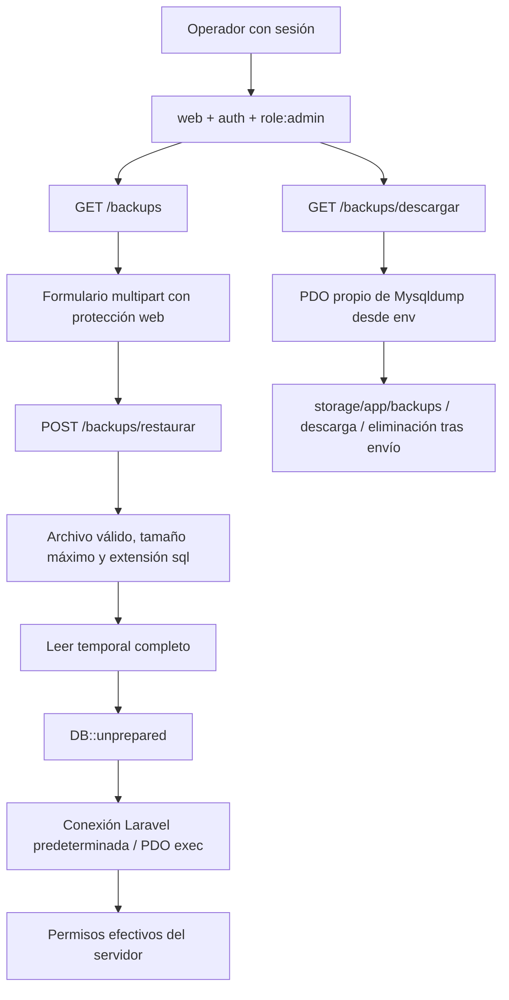

# R01 — Auditoría estática de restauraciones

Fecha: 21 de noviembre de 2026. Fuente revisada: commit `7c99cbc`, árbol limpio al comenzar. Alcance: exportación/restauración web y sus dependencias directas. **Solo diagnóstico; no se ejecutó código del ERP, SQL, backups, restauraciones ni pruebas de aplicación. Único archivo creado: este informe.**

**Dictamen:** el circuito tiene autenticación, autorización por rol y protección de solicitudes web, pero no proporciona controles suficientes para acreditar procedencia, destino autorizado, preservación de evidencia o recuperación ante restauración parcial. No debe confundirse el permiso para entrar a la pantalla con una autorización verificable para sobrescribir una base concreta. `DB::unprepared` es el ejecutor de SQL; el problema es el contrato de confianza y recuperación que lo rodea, no la mera presencia de ese método.

Los hallazgos «confirmados» son propiedades del código inspeccionado, no reproducciones SQL ni prueba de incidentes. Destinos efectivos, cuentas, grants, contenido de respaldos, permisos de archivos y efectos en producción **no fueron medidos**. Este informe no constituye una auditoría completa de todo el ERP.

## 1. Arquitectura vigente

`routes/web.php:66,304,385–387` registra los tres endpoints dentro de `auth` y `role:admin`. `bootstrap/app.php:10–25` los carga como rutas web y registra el alias role. No se encontró otro consumidor de `RespaldoController` ni una Policy/Gate adicional aplicada a estas rutas.

`RespaldoController::restore`, líneas 63–93: valida subida → comprueba extensión original → lee temporal → manda todo el texto a la conexión por defecto → flash de éxito o error. No llama a servicios de inventario, ventas, nómina, cuentas o contabilidad. No participa en un protocolo de recuperación coordinada con esos módulos.

`download`, líneas 21–60: crea nombre con precisión de segundos, directorio local de respaldos y un PDO independiente mediante `ifsnop/mysqldump-php`; solicita DROP TABLE, genera SQL, devuelve descarga y pide eliminar el archivo tras enviarlo. Composer declara `^2.12` y el lock contiene `v2.12`. Se inspeccionó esa dependencia local sin ejecutarla.

## 2. Permisos y autorizaciones

| Principal | Resultado previsto por código |
| --- | --- |
| Anónimo | `auth` impide llegar al controlador; respuesta/redirect dependen de la petición web |
| Rol `admin` autenticado | Puede abrir pantalla, descargar y ejecutar restore |
| Rol `alvaro` autenticado | También puede, por bypass explícito del RoleMiddleware |
| `contador`, `recepcion`, `estilista` y otros roles | No figuran en este grupo; middleware deniega, salvo que su rol sea alvaro |

Autoridad efectiva: `RoleMiddleware.php:29–55` comprueba sesión y el campo `role`, reconoce bypass de **alvaro**, luego compara roles permitidos. El comentario antiguo de AGENTS sobre bypass admin no sustituye el código actual: admin entra aquí porque está enumerado. No se consultaron usuarios reales ni se deduce acceso desde `role_id` o el menú.

`config/auth.php:16–19,42–45,64–66` declara guard web de sesión y modelo Usuario por defecto, con variables de configuración posibles. No se cargaron sus valores secretos o efectivos. La pantalla y menú no son el control de acceso; lo es el middleware.

La vista `backups/index.blade.php:65–83` contiene CSRF, selección de archivo y una advertencia de borrado con botón de confirmación. El grupo web local incluye `PreventRequestForgery`; no se observó exclusión de esta ruta. En Laravel local esa protección admite origen válido o token según su configuración: no se afirma que todo POST sin token necesariamente dé 419. No se probó el kernel HTTP.

El modal es confirmación **visual**, no autorización del hecho de recuperación: restore no exige PIN, reautenticación reciente, aprobación del propietario, token de operación, identificación escrita del destino ni referencia de acta. Tampoco comprueba específicamente `is_active` en este circuito. La política de qué operador debe autorizar recuperación total sigue siendo decisión del propietario; no se cambia aquí.

Un admin con este permiso obtiene una capacidad de recuperación de todo el esquema, incluidas tablas financieras y de usuarios si tiene privilegios SQL. Eso puede exceder otras capacidades de su rol en el ERP. Es una delegación explícita que debe revisarse, **no** se presenta como acceso anónimo ni escalada demostrada de un usuario sin ese permiso.

## 3. Procedencia y validación de archivos

**Se admite un archivo SQL cargado por el operador; no se limita a respaldos emitidos por el sistema.** La interfaz dice «previamente descargado», pero el servidor no verifica esa procedencia.

Controles existentes en `RespaldoController.php:65–73`:

- `required|file|max:51200`: archivo subido válido con límite Laravel de 51.200 KiB; PHP/proxy pueden imponer otro menor, no inspeccionado.
- `getClientOriginalExtension() === 'sql'`: sufijo original, sensible a mayúsculas. Symfony lo obtiene del nombre proporcionado por el cliente (`UploadedFile.php:95–98`). No identifica formato ni autenticidad.
- El navegador usa `accept=.sql`; es ayuda visual, no control del contenido.
- Se lee `getRealPath()` del upload temporal, no una ruta de lectura enviada libremente por el cliente. No hay uso del nombre original para construir una ruta de destino.

No hay firma, manifiesto, hash esperado custodiado, ID de respaldo, emisor, versión de aplicación/esquema, fecha/corte autorizado, lista de tablas, integridad completa, motor o compatibilidad comprobados. Un hash calculado del mismo archivo cargado, sin referencia confiable, tampoco acreditaría origen.

No se valida el contenido ni se fija un catálogo de sentencias. No hay rechazo de cambios de base, calificadores de otros esquemas, operaciones de usuarios, triggers/definers, instrucciones de sistema o comentarios ejecutables. El límite real queda en el servidor y sus privilegios, no en una política SQL de la aplicación.

La extensión no habilita ejecución PHP: este circuito pasa el archivo como texto a la base, no a `include` ni shell. No se encontró recorrido de path traversal a partir del nombre cargado; no se atribuye ese defecto por analogía con otras subidas.

### Almacenamiento y respaldo generado

El upload se consume desde el temporal de PHP; no se archiva con identidad/evidencia inmutable. El exportador usa directamente `storage_path('app/backups')`, fuera de public en la configuración de fuente, y nombre `Respaldo_SalonERP_YYYY-mm-dd_H-i-s.sql`. No usa el disco privado configurado ni crea una custodia documental; tras el envío solicita borrar el archivo. No se puede afirmar que el cliente lo guardó o que existe una copia recuperable.

Un fallo de generación no tiene limpieza/finalización explícita de parciales. El nombre a segundos permite colisión entre descargas concurrentes y no se reserva exclusivamente. La rama exitosa usa `deleteFileAfterSend`; el detalle de supervivencia/colisión ante errores depende del servidor y debe ensayarse. `0755` no demuestra ACL seguras en Windows; no se inspeccionaron directorios ni se leyeron dumps históricos. No hay evidencia de exposición pública directa, cifrado o retención efectiva.

Los respaldos pueden contener datos de clientes, usuarios, hashes/tokens, evidencia AC-04/AC-05 y migraciones porque el exportador no configura exclusiones. No se abrió ningún archivo para comprobar contenido personal. Ese alcance exige custodia; no es permiso para copiarlo a un laboratorio.

## 4. Identificación del destino

`restore` no acepta un nombre de base en un campo HTTP, lo cual evita ese selector directo. Sin embargo, tampoco fija o verifica el destino: `DB::unprepared` se resuelve mediante `DatabaseManager::getDefaultConnection` (`DatabaseManager.php:94–107,393–396`). El controlador no elige una conexión separada ni valida instancia, UUID, host/puerto, datadir, esquema, usuario o grants efectivos antes de ejecutar.

`config/database.php:20,47–64` toma el driver predeterminado de DB_CONNECTION y configura MySQL con DB_URL, host, puerto, base, cuenta y socket. Una URL puede prevalecer al ser interpretada por `ConfigurationUrlParser`; el cache de configuración puede determinar los valores en vez del .env actual. No se leyó `.env` ni cache de configuración. **No se identifica como hecho cuál de las tres bases está seleccionada actualmente.**

No hay lista de destinos autorizados ni denegación de `salon_erp`, `salon_erp_test`, `salon_erp_bootstrap_check`. Tampoco se integran `H05DisposableSafety`, las guardas de tests ni el indicador de reset. APP_ENV=testing no constituye aislamiento de restore.

Además, seleccionar una base inicial no confina SQL a ella: un archivo puede referir otro esquema o cambiar el esquema activo si el usuario SQL tiene permiso. No se ha demostrado acceso cruzado real. Se requiere aislamiento de cuenta/servidor, además de la inspección del formato admitido; cambiar únicamente DB_DATABASE no es garantía.

**Divergencia de exportación:** `download:33–45` crea DSN MySQL desde `env(DB_HOST/DB_DATABASE/DB_USERNAME/DB_PASSWORD)` y omite DB_PORT, DB_URL, DB_SOCKET, selección de conexión y opciones Laravel. No reutiliza el destino efectivo del gestor. Un entorno con puerto no predeterminado, URL o config cacheada puede exportar una base distinta o fallar, aunque restore use otra. La divergencia de implementación está confirmada; que ocurra en esta instalación queda sin verificar. No se presupone que el exportador apunte hoy a 3306 ni se intenta comprobarlo.

## 5. Privilegios SQL

Se reutiliza la identidad runtime del ERP para restaurar. No se encuentra cuenta de recuperación, vida limitada, comprobación de grants ni prohibición de privilegios globales. `config/database.php` declara fallback de nombre root, pero **no demuestra que se use root ni privilegios excesivos actualmente**. Sin leer credenciales ni consultar SQL, los grants efectivos son desconocidos.

| Necesidad legítima | Permisos a delimitar en fase posterior |
| --- | --- |
| Exportación | Lecturas/metadatos del esquema autorizado; privilegios adicionales solo según objetos exportados y política consistente |
| Restauración de tablas/datos | Permisos sobre un único destino: según formato aprobado, CREATE/DROP/INSERT y los ALTER/INDEX/LOCK TABLES que realmente emita el dump |
| Vistas/triggers/rutinas | Aprobar primero soporte y definers; no resolver fallos concediendo automáticamente privilegios globales |
| Preflight/verificación | Identidad, estructura y resultado desde consultas controladas en entorno autorizado; no se ejecutaron aquí |

No se necesita por defecto GRANT OPTION, administración de usuarios, FILE ni autoridad sobre otros esquemas para restaurar el ERP en un destino limitado. La lista exacta depende del formato/objetos aprobados y debe validarse en laboratorio; no es un GRANT propuesto para ejecutar ahora. La cuenta runtime ordinaria debe mantenerse separada de la identidad temporal de recuperación. Limitarla sin sustituir el circuito rompería restauraciones actuales: requiere aprobación y plan de compatibilidad.

## 6. Atomicidad y recuperación ante errores

El controlador no abre transacción ni gestiona rollback; entrega un lote completo a `Connection::unprepared`, cuyo código local (`Connection.php:642–654`) llama a PDO `exec` sin parámetros. Un parser/caso de uso de dominio no interviene.

**Múltiples sentencias:** no existe veto local de multi-statements. El conector Laravel fija emulación de prepared statements a false, lo cual no transforma este `exec` en una sentencia preparada. El código oficial PDO_MYSQL de PHP 8.3 habilita multi-statements por defecto salvo opción contraria y su ejecutor procesa resultados múltiples. Esto sustenta la capacidad prevista, no una medición del binario o configuración en uso. El comportamiento exacto se reserva al laboratorio. [Fuente primaria: PDO_MYSQL, factory y doer](https://raw.githubusercontent.com/php/php-src/PHP-8.3/ext/pdo_mysql/mysql_driver.c).

**Destrucción legítima ya configurada:** `download:41` pide `add-drop-table=true`. La dependencia local genera DROP TABLE y DDL/datos; sus defaults incluyen locks en salida y gestión de autocommit. `single-transaction=true` corresponde al snapshot **de exportación**, no a una garantía de restauración indivisible. Por defecto no selecciona modo databases; no se debe atribuir CREATE DATABASE/USE al dump normal sin condición. Un upload externo sí puede contenerlos porque no se filtra.

Ante error intermedio pueden sobrevivir cambios anteriores. MySQL 8.4 realiza commits implícitos con gran parte del DDL y ciertas instrucciones de transacción/locks. Añadir un `DB::transaction` alrededor de este archivo no garantizaría un rollback completo. [MySQL 8.4: commits implícitos](https://dev.mysql.com/doc/refman/8.4/en/implicit-commit.html). Atomic DDL hace atómica una operación compatible, no la secuencia completa de un dump. [MySQL 8.4: atomic DDL](https://dev.mysql.com/doc/refman/8.4/en/atomic-ddl.html).

No se encontró una promesa explícita de atomicidad transaccional: la UI avisa destrucción. Sí existe un mensaje uniforme de éxito sin verificación de restaurabilidad, versión, conteos, evidencias, integridad económica o cierre de todas las operaciones. Un lote aceptado no demuestra restauración empresarial correcta.

El catch captura Exception, escribe un log y vuelve con mensaje genérico; no hay inventario del punto alcanzado, cuarentena del destino parcial, recuperación a una copia validada ni registro de resultado incierto. Error/ValueError y otros Throwable no capturados pasan al handler general según configuración; `APP_DEBUG` efectivo no se inspeccionó. `file_get_contents` se hace completo en memoria y no se valida explícitamente lectura íntegra. Se desconocen límites web, memoria, timeout, packet y tamaño real de bases.

La propia conexión Laravel puede reconectar y volver a ejecutar la consulta completa ante ciertos errores de conexión, fuera de transacción (`Connection.php:1010–1040`). No hay guardia especial para este lote destructivo: una respuesta perdida no acredita ausencia de efectos. El recorrido de reintento está en la fuente; su activación/impacto requiere laboratorio.

**Compatibilidad de formato:** el exportador local admite triggers y conserva definer por defecto; `create_trigger:1968–1990` emite DELIMITER. Esa es una directiva del cliente mysql, no SQL que PDO procese como un cliente de dumps; el controlador no la interpreta. No se sabe si las bases contienen triggers, por lo que no se declara fallido un respaldo real. [MySQL: uso de delimiter en el cliente](https://dev.mysql.com/doc/refman/8.4/en/stored-programs-defining.html). No se recomienda reemplazarlo sin revisión por el importador de la misma biblioteca ni dividir ingenuamente por punto y coma.

## 7. Auditoría y trazabilidad

| Dato requerido | Evidencia en restore |
| --- | --- |
| Actor y rol autorizante | Middleware autoriza; no se registra actor en un evento documental de restauración |
| Origen/ID/hash/firma de archivo | No registrado/validado |
| Destino e identidad efectiva | No comprobado ni registrado |
| Fecha e ID de operación | El logger puede fechar errores; no hay run ID o registro de intento/éxito/resultados |
| Autorización empresarial | Modal únicamente; no PIN ni documento/consentimiento asociado al destino |
| Resultado | Flash temporal de éxito/error; solo errores registrados expresamente |
| Estado parcial e integridad posterior | Sin evidencia específica |
| Reenvío/concurrencia | Sin UUID, deduplicación, bloqueo exclusivo ni autorización de uso único |

Logs de acceso de infraestructura, si existieran, no se inspeccionaron ni prueban procedencia/destino/consentimiento. Una auditoría guardada dentro del esquema que se restaura podría ser reemplazada por el propio archivo; la evidencia de recuperación futura debe conservarse fuera del destino y con custodia aprobada.

**Filtración al log confirmada por trazado:** restore guarda `$e->getMessage()` y stack (`:86–90`). Laravel envuelve errores de ejecución en QueryException con el SQL recibido y `formatMessage:83–87` lo incorpora al mensaje. Como aquí la consulta es el archivo entero, un error PDO puede copiar el lote al log, incluidos datos/hashes que contenga. No se abrió un log ni se afirma una fuga ya ocurrida. Retención, receptores y ACL de logs efectivos son desconocidos; `config/logging.php` admite varios canales y no contiene una redacción específica de este flujo.

Al operador se le envía un mensaje genérico, que es un control útil frente a exposición directa de detalles SQL. El mensaje atribuye el problema posiblemente al archivo corrupto, sin advertir expresamente que el destino puede estar parcialmente cambiado. El éxito no genera auditoría explícita. Existen funciones de notificación de respaldo en `NotificationService`/trait Notificable, pero RespaldoController no las usa; su mera existencia no acredita registro o monitorización de recuperación.

## 8. Hallazgos confirmados y matriz de riesgos

Prioridades de intervención: **P1**, atender antes de autorizar uso sobre bases históricas; **P2**, endurecimiento/compatibilidad del flujo antes de considerarlo recuperación verificada. No son afirmaciones de explotación o incidentes reales. Todos comparten las rutas indicadas y requieren un operador con permiso web, una sesión comprometida de ese rol o un error operativo equivalente; no se afirma alcance anónimo.

| ID / riesgo | Ruta/método y evidencia precisa | Impacto y condiciones | Medidas existentes | Corrección mínima sugerida | Compatibilidad/efecto secundario | Prioridad |
| --- | --- | --- | --- | --- | --- | --- |
| R01-01. Origen y lenguaje sin contrato | POST restaurar, `restore:65–82`; valida archivo/extensión y ejecuta su texto íntegro | Upload equivocado/manipulado puede alterar cualquier objeto permitido a la cuenta, eludiendo servicios de dominio | Auth/rol/protección web, archivo y tamaño, sufijo | Solo artefacto autorizado con manifiesto confiable; formato SQL explícito y revisión de objetos/alcance; rechazo antes de abrir ejecutor | Los SQL libres dejan de aceptarse; respaldos antiguos necesitan revisión/atestación, sin firmarlos retroactivamente por su nombre | P1 |
| R01-02. Destino no identificado y fuentes divergentes | `restore:82`, `download:33–45`; DB default frente a PDO propio sin puerto/URL/socket | Configuración cambiada/cacheada, archivo de otro entorno o SQL cualificado pueden apuntar fuera del destino esperado, si los grants lo permiten | Destino no se elige directamente en formulario; restricción final del servidor | Preflight de identidad/conexión explícita, manifiesto y allowlist de destino; cuenta aislada; exportar desde el mismo destino resuelto | Requiere adaptar exportador; no se asume ni cambia configuración real | P1 |
| R01-03. Resultado parcial sin recuperación | `restore:76–92`, `download:41`; lote DDL sin plan de fallo | Error, desconexión o timeout después de parte del archivo deja datos/esquema parciales o inciertos | Captura Exception y mensaje genérico; advertencia de borrado | Recuperación fuera del tráfico normal y sobre destino nuevo ensayado; plan de fallo/atestación antes de sustituir destino; no prometer rollback del dump | Necesita mantenimiento/copia verificada y decisión explícita de recuperación; envolver en TX no lo arregla | P1 |
| R01-04. Contenido de respaldo en log de error | `restore:87–90` + `Connection::runQueryCallback` + `QueryException::formatMessage:83–87` | Error SQL puede duplicar datos sensibles/evidencia en canales de log con custodia diferente | Error web genérico; logs configurables | Log de operación estructurado y error sanitizado sin SQL/bindings/traza con contenido; diagnóstico separado controlado | Menos detalle automático; conservar código de error y referencia de incidente sin el dump | P1 |
| R01-05. Autorización y auditoría no ligadas al hecho | `routes/web.php:304,385–387`, `restore` completo, vista `:65–83` | Operador puede ejecutar recuperación total sin prueba de consentimiento para ese archivo/destino; éxito no deja registro documental | Roles explícitos y confirmación visual | Definir autoridad de recuperación, reautenticación/autorización adicional y registro fuera del destino con actor/hash/destino/resultado | Propietario debe decidir si admin mantiene este alcance; no ampliar roles ni activar PIN por suposición | P1 |
| R01-06. Reenvío, reintento y concurrencia sin exclusión | Form multipart sin token de operación; `restore` sin estado/lock; `Connection:1010–1040` | Doble envío, dos operadores, negocio concurrente o reconnect automático pueden repetir/intercalar efectos | POST y protección web no son idempotencia | Operación con identidad/consentimiento de uso único, exclusión de restauraciones y escritores, resultado incierto sin reintento ciego | Reenvío deja de importar otra vez; una nueva recuperación exige intención nueva aprobada | P1 |
| R01-07. Sin compatibilidad o conciliación posterior | `restore:82–84` devuelve éxito sin manifiesto/esquema/resultados | Respaldo válido pero antiguo/incompleto restaura otro modelo, borra evidencia reciente o deja código y datos incompatibles | Archivo generado por biblioteca disponible; no hay verificación semántica | Comprobar perfil/versión/objetos y ejecutar verificación posterior en destino aislado; promoción autorizada solo tras aceptación | Rechaza restauraciones antes aceptadas a ciegas; no ejecutar migraciones automáticas para acomodarlas | P1 |
| R01-08. Custodia y colisión en exportación | GET descargar, `download:23–31,48–59`; timestamp a segundos, sin reserva exclusiva/finalización de parcial | Dos descargas pueden compartir nombre; un fallo puede dejar archivo incompleto/sensible; descarga no prueba copia preservada | Nombre generado en servidor, fuera de public por fuente, eliminación tras envío | Identidad aleatoria exclusiva, archivo parcial/finalizado y manifiesto, almacenamiento privado y política de retención/evidencia de copia | Cambia nombre/custodia y consumo de disco; no borrar históricos ni parciales actuales automáticamente | P2 |

Las medidas son propuestas; **ninguna fue implementada**. R01-01 describe falta de validación/procedencia en un importador SQL deliberado, no una inyección convencional que se resuelva añadiendo placeholders a un dump.

### Respuesta consolidada a las 15 preguntas obligatorias

| N.º | Respuesta |
| --- | --- |
| 1 | Admin y alvaro autenticados por los grupos y bypass vigentes; otros roles no enumerados se deniegan |
| 2 | SQL subido por usuario autorizado; no restringido a generación propia |
| 3 | No se acredita origen: archivo/tamaño/extensión no son firma/manifiesto |
| 4 | Conexión Laravel por defecto; el exportador usa otra resolución independiente |
| 5 | No hay control explícito de destino ni de las tres bases protegidas; los grants efectivos son desconocidos |
| 6 | Sin allowlist SQL de aplicación; lo que permita el servidor/cuenta y acepte el driver |
| 7 | El exportador configura DROP TABLE; el upload puede contener otras destructivas, sin que eso demuestre permisos para ejecutarlas |
| 8 | Se entrega el lote completo a exec; el soporte multi está previsto por PDO_MYSQL y no se veta localmente; ejecución real pendiente |
| 9 | Puede quedar aplicado un prefijo; catch no recupera ni determina el estado final |
| 10 | No promete explícitamente atomicidad; tampoco ofrece garantía. Snapshot de exportación y atomic DDL no hacen atómico el archivo |
| 11 | No determinable sin identidad/grants; sí se confirma reutilización de cuenta runtime y ausencia de separación/control |
| 12 | No existe registro documental completo de actor/origen/destino/autorización/resultado; solo error y flashes |
| 13 | No hay protección de reenvío; además existe recorrido de retry de conexión en Laravel |
| 14 | Mensajes web capturados son genéricos; el log puede incorporar SQL completo. Handler general/debug no se midieron |
| 15 | Sí, SQL directo elude validadores y servicios de inventario/venta/nómina/contabilidad, sujeto a permisos y SQL ejecutable |

## 9. Riesgos potenciales pendientes de validación

No se clasifican como incidentes confirmados ni se asigna severidad basada en configuración desconocida:

- Grants globales, root efectivo o capacidad real de escribir otra base, archivos del servidor, usuarios, definers o rutinas. No se consultaron grants ni credenciales.
- Conexión efectiva que hoy seleccione alguna base histórica, o exportación que realmente alcance un puerto equivocado. Solo se confirma ausencia de guardas y divergencia de resolución.
- Dumps con triggers/DELIMITER, tipos de objetos o definers incompatibles con el ejecutor. No se inventan triggers existentes.
- ACL NTFS, enlaces/redirecciones, servicio HTTP exponiendo backups/logs, cifrado y almacenamiento real del cliente. Las rutas de fuente no prueban despliegue ni permisos.
- Agotamiento de memoria/tiempo/espacio con archivos grandes, packet limit o logs voluminosos; no se midieron cuotas ni se provocó carga.
- Sesiones, colas o conexiones activas continuando escrituras durante la restauración; SESSION_DRIVER declara database por defecto, pero el valor efectivo y procesos activos no se inspeccionaron. Guardar sesión al terminar la petición también debe incluirse en el ensayo de recuperación.
- Acceso de usuario inactivo con sesión ya vigente, según el resto de la autenticación/configuración. El circuito no añade ese control y no se probó la sesión real.
- Restaurabilidad de backups aprobados o recuperación de evidencias AC-04/AC-05. Que documentos anteriores registren SHA256 no demuestra restauración ni autoriza ensayarla sobre los originales.

## 10. Controles que ya funcionan por diseño

1. No es endpoint público: sesión y roles delimitados, con bypass alvaro intencional.
2. Formulario POST multipart y protección web configurada, sin excepción observada de restore; no se declara ausencia de CSRF.
3. Validación del upload y tamaño; sufijo `.sql` como filtro superficial, no autenticidad.
4. Lectura desde temporal de upload, sin un parámetro libre de ruta o URL; exportación con nombre generado por servidor.
5. Advertencia visible de pérdida de datos y elección explícita de archivo; mensajes capturados no devuelven SQL al operador.
6. Generación con biblioteca versionada y snapshot de exportación por defecto, valioso bajo sus restricciones, sin atribuirle consistencia frente a todo DDL concurrente o restaurabilidad verificada.
7. Eliminación solicitada después del envío evita retener indefinidamente cada descarga exitosa, aunque no sustituye custodia ni confirma recepción.

La documentación técnica y herramientas restringidas de respaldo/test tienen controles de identidad y hashes. No están invocadas por esta ruta. No se deben trasladar a ella garantías que pertenecen a otro procedimiento.

## 11. Correcciones mínimas propuestas, sin implementar

Orden recomendado para autorización posterior:

**Contención reversible.** El propietario debe decidir si se deshabilita temporalmente solo la importación HTTP o se restringe a un procedimiento de recuperación expresamente autorizado. No se bloqueó ahora. Conservar acceso de consulta/exportación solo según permisos/custodia aprobados; no eliminar la funcionalidad ni modificar roles globales como atajo.

**Contrato de recuperación.** Definir archivo/manifiesto y emisor confiables, perfil de esquema/código, alcance de evidencia histórica y destino exacto. Un archivo legado necesita validación/atestación explícita antes de aceptarse; no confiar en nombre, extensión o hash autocertificado. La autorización debe estar ligada a hash, destino y operación de uso único, con vigencia y actor autorizante, reutilizando mecanismos existentes cuando su política sea aplicable.

**Ejecución separada del runtime normal.** Cuenta/entorno acotados al destino aprobado, sin grants globales/cross-schema, escritores del negocio detenidos y rechazo de destinos no autorizados. Preferir restauración y validación en destino nuevo aislado; promover solo mediante decisión de recuperación explícita y conservar el anterior. No introduce microservicios ni obliga a una arquitectura distribuida: puede ser un procedimiento/ejecutor delimitado fuera de la petición normal. Crear recursos, cuentas o cambiar configuración será autorización independiente.

**Formato y resultado.** Usar un ejecutor compatible con el formato aprobado y sus objetos; resolver SQL cualificado, comentarios ejecutables, strings, rutinas y delimitadores sin regex/listas negras o cortes por `;` ingenuos. No recomendar arbitrariamente desactivar múltiples sentencias y seguir enviando el mismo dump: rompería el importador sin resolver origen/destino. No dar éxito hasta verificar estructura y datos previstos; fallo/estado incierto conserva evidencia, bloquea reintento automático y requiere revisión. Sin migraciones/seeders automáticos para conseguir compatibilidad.

**Auditoría y privacidad.** Registrar intento/autorización/inicio/fin o incertidumbre fuera de la base restaurada; actor/rol, ID, hash/manifiesto, identidad de destino, versión, timestamps, resultado y verificación, sin contraseñas, PIN, SQL completo o datos personales del dump. Sanitizar errores de QueryException; mantener identificador/código para diagnóstico controlado. Un segundo paso de recuperación necesita nueva autorización, no ocultar el primero como rollback.

**Exportador.** Resolver conexión/puerto/socket desde la configuración efectiva aprobada, reservar nombre exclusivo, archivo parcial/finalizado y manifiesto verificable, custodia privada y prueba de recepción/retención según política. La exportación web actual no debe considerarse por sí sola un plan de contingencia.

Estas propuestas no cambian las fórmulas, políticas económicas ni el esquema del ERP. Una restauración total reemplaza historia por definición; decidir cuándo se acepta esa pérdida y cómo preservar evidencia es una decisión empresarial necesaria, no algo que resuelva un validador de archivo.

## 12. Pruebas necesarias para Debian independiente

**No ejecutadas ni autorizadas en esta fase.** Solo datos sintéticos, instancia aislada sin rutas a las tres bases históricas, cuenta nueva, límites de recursos y ausencia de credenciales reales. Preparar autorización separada para DDL/DML/restauraciones de laboratorio; nunca usar un dump histórico como fixture ni como ruta de preflight.

| Grupo | Ensayo y aceptación futura |
| --- | --- |
| Acceso web | Anónimo/roles, sesión inválida, protección web según Laravel, autorización reciente y destino explícito; verificar que una solicitud rechazada no llega al ejecutor |
| Procedencia | Archivo ajeno/manipulado, extensión falsa, vacío/truncado, tamaño, manifiesto/firma/versiones y fuentes legadas revisadas; sin ejecución en rechazo |
| Identidad/privilegios | Config/URL/puerto/socket/cache discordantes; usuario/esquema/servidor no autorizado. Rechazo antes de escritura y denegación real de otros destinos sintéticos |
| Dialecto SQL | Objetos permitidos, múltiples sentencias, calificadores, comentarios ejecutables, strings con `;`, triggers/DELIMITER/definers; sin recortar o ignorar silenciosamente objetos |
| Parcialidad | Lote sintético con DDL/DML y fallo intermedio; medir desde segunda conexión qué persistió. No envolver en transacción exterior y declarar rollback del dump |
| Desconexión/reintento | Pérdida de respuesta, caída después de cambios, retry del driver/gestor; una operación incierta no reejecuta a ciegas ni se marca exitosa |
| Concurrencia | Dos restauraciones y escritores/sesiones/colas sintéticos simultáneos; demostrar exclusión operativa efectiva, no solo un flag de mantenimiento |
| Auditoría | Intento/éxito/error/timeout/denegación, actor, autorización, hash, destino y resultado verificable; auditoría sobrevive al reemplazo y no contiene SQL/secretos |
| Exportación/archivos | Mismo segundo, fallos parciales, desconexión de descarga, custodia y límites; manifest corresponde exactamente a bytes/origen/destino aprobados |
| Recuperación funcional | Validar versión, tablas/constraints y relaciones; inventario/lotes/ledger, documentos/pagos/comisiones, nómina, mayor y evidencia sintética completa; rollback operativo hacia destino preservado bajo autorización |

Pruebas puras futuras pueden verificar estados de operación, manifiestos, consentimiento/destino y errores sanitizados con un puerto de ejecución que solo registre invocaciones ficticias. No llamar al restore actual o a `DB::unprepared` para simular que se cumplieron requisitos que todavía no tiene. Un mock no prueba MySQL ni permisos reales.

## 13. Dependencias y decisiones pendientes

- Propietario: quién puede autorizar reemplazo total; si admin conserva esa capacidad o requiere autorización adicional; ventanas de recuperación, RPO/RTO y respuesta a resultado incierto.
- Custodia: origen confiable, retención/cifrado/ACL, responsable de manifiestos y evidencia de autorización, incluido historial AC-04/AC-05. No copiar backups existentes para decidirlo.
- Plataforma: formato y ejecutor soportados, identidad temporal de recuperación y separación de runtime, destino y proceso de promoción/reversa operativa. Debian sigue pendiente; no se inicia ni se reabre H05/WFP.
- Compatibilidad: backups previos, tablas/opciones/objetos, migraciones registradas y código actual. H01/H03/H04/H05/H06-P1/H07/H08/H09/H11 protegen casos de uso ordinarios; SQL directo no los invoca. Sus puertas y políticas permanecen intactas, no se usan como permiso para restaurar.
- Conservación: inventario y costos históricos, facturas/comisiones congeladas, nóminas/colillas y clasificación/auditoría AC-05 no se reconstruyen ni reinterpretan. Restaurar una copia vieja puede eliminar evidencia posterior aun si el SQL es técnicamente válido.

## 14. Archivos y fuentes inspeccionados

Fuentes del ERP y configuración declarativa, sin secretos:

- `app/Http/Controllers/RespaldoController.php`, controlador base y `AutenticacionController.php`.
- `routes/web.php`, `routes/console.php`, `bootstrap/app.php`, `bootstrap/providers.php`.
- `app/Http/Middleware/RoleMiddleware.php`, `app/Models/Usuario.php`, `app/Providers/AppServiceProvider.php`.
- `resources/views/backups/index.blade.php`, referencias del menú en `resources/views/layouts/app.blade.php`.
- `config/database.php`, `auth.php`, `session.php`, `logging.php`, `filesystems.php` y referencia de debug de `app.php`; solo código/variables declaradas, no valores efectivos secretos.
- `app/Traits/AutorizaPinSupervisor.php`, `Notificable.php`, `app/Services/NotificationService.php`: controles existentes y falta de integración con restore.
- `composer.json`, sección versionada pertinente de `composer.lock`; `AUDITORIA_MANTENIBILIDAD.md`, `AGENTS.md`, referencias en `Como_trabajar.md`, `docs/H01_R_TRAZABILIDAD_INVENTARIO.md` y pasaje de recuperación de `docs/PRUEBAS_SEGURAS.md`.
- `tests/Support/H05DisposableSafety.php` y fragmentos de fuente de `ac04b1-backup.php`, solo para distinguir otros circuitos; no se ejecutaron. Búsqueda de consumidores/tests de restauración en app/rutas/tests/docs, sin leer evidencia SQL histórica.
- Dependencias locales: Laravel DatabaseManager, Connection, QueryException, Connector/MySqlConnector, ConfigurationUrlParser, LoadConfiguration/LoadEnvironmentVariables, validadores de archivos y grupo web/PreventRequestForgery; Symfony UploadedFile; `vendor/ifsnop/mysqldump-php/src/Ifsnop/Mysqldump/Mysqldump.php`.
- Referencias primarias MySQL/PHP enlazadas en §6 para límites del motor/driver. Consultar documentación pública no ejecutó SQL ni consultó servidores del ERP.

No se corrió PHPUnit, Artisan route:list, builds o código controlado por el proyecto. La inspección estática basta para los defectos de contrato descritos; la semántica dinámica y las preguntas de despliegue quedan expresamente sin demostrar. No se añaden tests que afirmen restauración segura a partir de mocks.

## 15. Preservación de bases y archivos

No se abrieron conexiones a `salon_erp`, `salon_erp_test` o `salon_erp_bootstrap_check`; no hubo SQL, `DB::unprepared`, backups, restauraciones, migraciones, seeders, RefreshDatabase ni pruebas empresariales. No se leyeron `.env`, configuración cacheada, credenciales, logs, dumps o archivos históricos. No se modificó evidencia AC-04/AC-05 ni archivos funcionales, configuración, H01/H03/H04/H06-P1, servicios o permisos.

No se instaló infraestructura ni se ejecutaron despliegues u operaciones Git de escritura. Única escritura autorizada realizada: `docs/R01_AUDITORIA_RESTAURACIONES.md`. La preservación se sustenta en ausencia de operaciones sobre las bases; no se afirma una nueva comparación SQL de sus contenidos.

## 16. Recomendación de intervención

Solicitar una fase específica de **contención y diseño de recuperación**, priorizando destino/identidad, autorización ligada al hecho, procedencia, errores sin contenido sensible y estado incierto sin reintentos ciegos. Cualquier bloqueo de la ruta vigente o cambio funcional necesita aprobación posterior; ninguno se aplicó aquí.

Después, aprobar y ensayar el procedimiento completo en Debian independiente con fixtures sintéticos antes de autorizar una recuperación histórica. No considerar suficiente cambiar el método SQL, poner una transacción, agregar MIME o exigir un segundo clic. El contrato debe controlar qué copia se acepta, quién autoriza perder/reemplazar historia, dónde puede ejecutarse y cómo se demuestra el resultado sin destruir la evidencia anterior.

R01 termina con este diagnóstico. No se inicia implementación, restauración, laboratorio, otra fase o despliegue.
